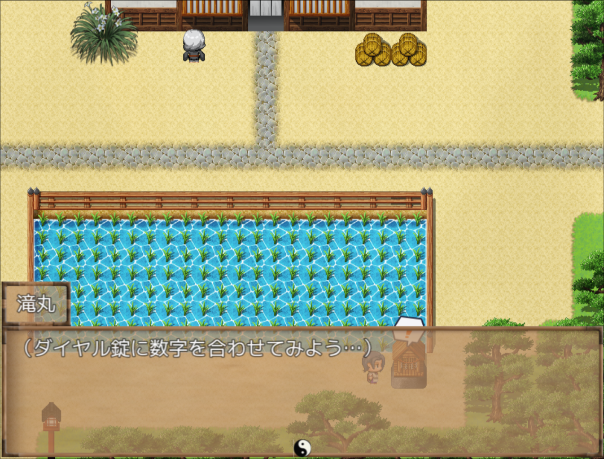
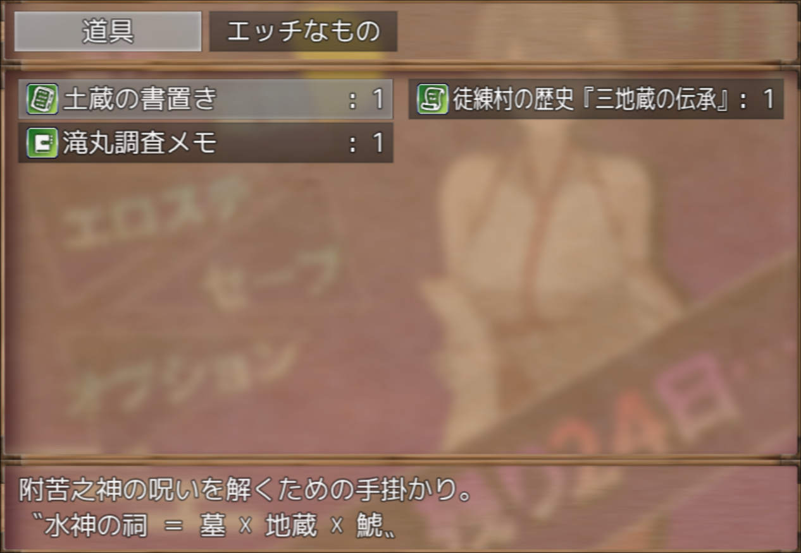
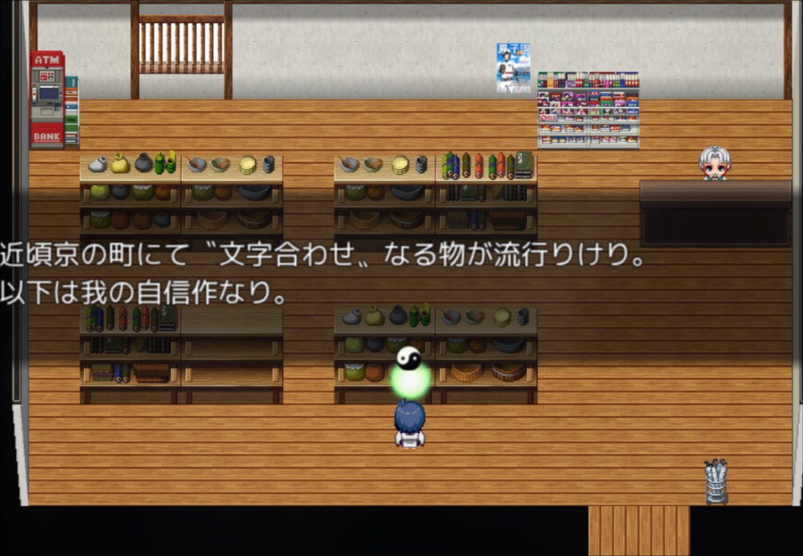
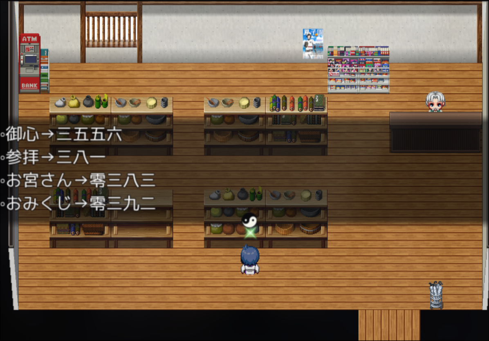
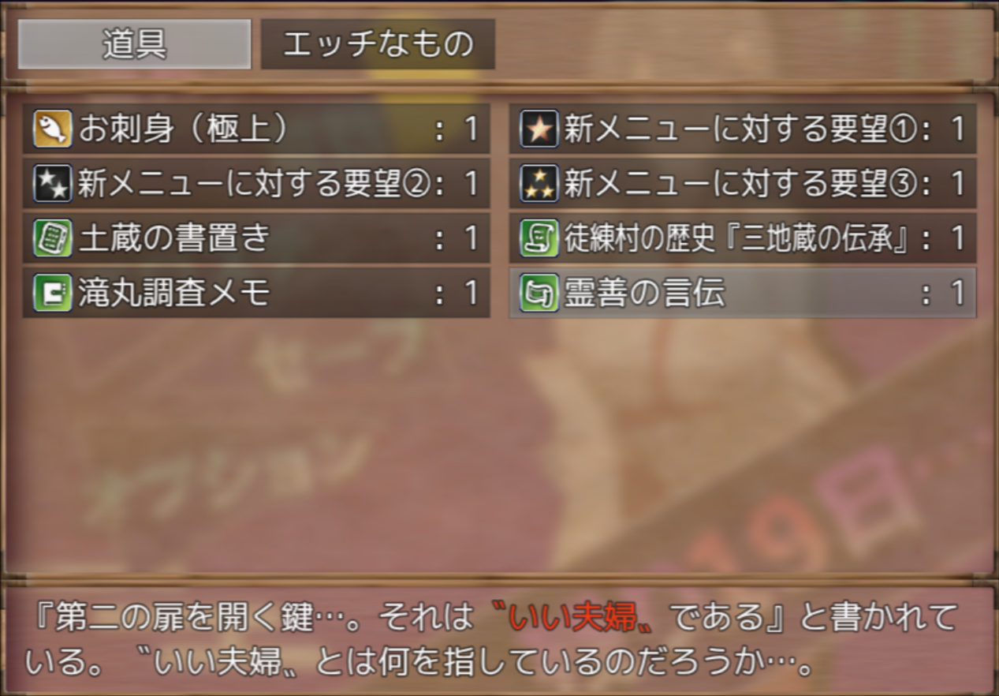

游戏地址在[DLsite](https://www.dlsite.com/maniax/work/=/product_id/RJ01511074.html)；

这个游戏要达成好结局的条件主要就是要解开ダイヤル[錠]^(じょう)(意为Dial锁，拨号锁)上的两层密码，从中获得宝珠来解除诅咒。

游戏针对这两层密码给了两层线索：

## 第一层密码

### 〝水神の祠 ＝ 墓 × 地蔵 × 鯱〟

> 这里`〟`是日文排版中的右侧双引号（下引号），日文名称是「右下げ二重かぎ括弧」。

这里`鯱`是日文汉字 「[鯱]^(じゃち)」，指虎鲸或逆戟鲸，这里指日本传统建筑上的鯱形装饰。

第一道锁的答案就是`墓碑(11)x地藏(5)x鯱(2)`的结果，也就是110。

## 第二层密码

第二层是给个日语单词到数字序列的小映射表，让我们来推测一个新词对应的数字序列。

### 映射表

映射表在商店新进的书中有写：

|日语单词|数字序列|
|---|---|
|[御心]^(みこころ)|3556|
|[参拝]^(さんぱい)|381|
|お[宮]^(みや)さん|0383|
|お[御籤]^(みくじ)|0392|

### いい夫婦

[霊善]^(れいぜん)の[言伝]^(ことづて)中提到了要破译的新词就是`いい夫婦`。

> [!NOTE]
> 霊善：这里应该是自造词，意为[善霊]^(ぜんりょう)，与[悪霊]^(あくりょう)对应。

> 悪霊退散！

> 搜索`霊善の言伝`关键词的时候还搜到了疑似作者本人在`Gamerch`上写的[攻略](https://gamerch.com/biim/956966#outline__%E6%A1%9C%E5%AD%90%E5%AF%9D%E5%8F%96%E3%82%89%E3%82%8C%E8%AD%9A%20%E5%A4%A7%E5%88%87%E3%81%AA%E3%81%93%E3%81%A8)。

嘛，至于到底该怎么推测，那我也不会，只好问了下chatgpt：

这很可能采用的是日语的「[語呂合わせ]^(ごろあわせ)」，即利用数字的日语读音来构成词语，详见[wiki](https://ja.wikipedia.org/wiki/%E8%AA%9E%E5%91%82%E5%90%88%E3%82%8F%E3%81%9B)

|数字|对应部分|
|---|---|
|1|いち、い、ひとつ、ひと、ひ、あい（字形から）、ぼう（字形から）|
|2|に、ふたつ、ふた、ふ、つ（英語から）、じ|
|3|さん、さ、みっつ、みつ、み|
|4|よん、よ、よっつ、よつ、し、ふぉ（英語から）、ほ|
|5|ご、こ、いつつ、いつ|
|6|ろく、ろ、むっつ、むつ、む、る（6を速く言うとそう聞こえることがある）|
|7|しち、ななつ、なな、な|
|8|はち、は、ば、ぱあ、やっつ、やつ、や、やあ|
|9|きゅう、きゅ、く、ここのつ、ここの、こ|
|0|れい、れ、ぜろ、ない、わ（字形から）、まる（字形から）、たま（字形から）、ま、お、おー・おう・おお（アルファベットのOから。）|

那么，参照这个表，`いい[夫婦](ふうふ)`对应的数字序列自然就是`1122`了，也就是第二道密码锁的答案。

> 另外，11月22日（いい夫婦の日）在日本也是非常有名的纪念日，寓意「好夫妻日」。

输入这两层密码就能解开ダイアル錠的锁获得宝珠以破除NTR结局啦！

---

最后吐槽一下，这个题目的设计真的很折磨外国人，这作者是不打算把作品卖给外国人是吗，怪不得一直没有推出官方中文版！
